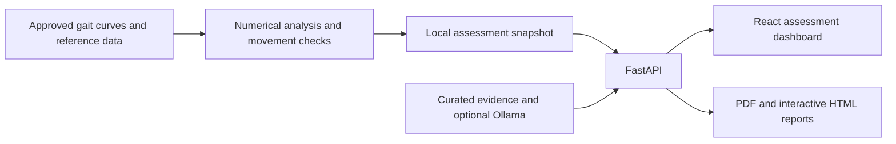

# Raycura · Better. Gait Assessment

A local gait-review prototype for examining recorded joint movement, comparing it with reference curves, and exporting an assessment. Built with **React and TypeScript**, **FastAPI**, **Plotly**, and **ReportLab**. The optional evidence assistant uses **Ollama**.

## What you can do

- **Explore ten motions** across the pelvis, hip, knee, and ankle. View either recorded walk or overlay both on the same graph. Toggle the reference curve, comparison-group spread, and recorded phase marks.
- **Understand the measurements.** See range of motion, the overall curve difference (RMS), and the average angle offset. Phase tables show the measured angle and printed comparison interval at each manual mark.
- **Review movement checks.** Inspect the exact angle, cycle interval, and rule behind a finding. The evidence view explains the recorded measurements and suggests muscle functions to examine when a supported pattern is present.
- **Export an assessment.** Download a framed, patient-named PDF or a standalone interactive HTML report.

<!--
Add GitHub-safe examples here after the README is reviewed. Suggested examples:
1. Two walks overlaid on one motion graph.
2. A phase-angle comparison and its explanation.
3. The framed PDF layout.
Use approved demonstration data. Keep patient names and assessment records out of the images.
-->

## Run on Windows

Use **Python 3.12**, **Node.js with npm**, and **PowerShell**. Open the project folder in VS Code and run the commands from its PowerShell terminal.

### 1. Install the Python dependencies

On a fresh checkout, create the virtual environment and install the pinned packages. An existing project environment can be reused.

```powershell
py -3.12 -m venv .venv
& '.\.venv\Scripts\python.exe' -m pip install -r requirements-lock.txt
```

### 2. Provide the local assessment data

Place the complete approved data package under `CSV's Folder/` at the project root. Preserve the package's original filenames and folder structure. Alternatively, set `prepared_data` in [config.json](config.json) to the approved package location.

The app reads its saved assessment snapshot from `results_pattern_prototype/stage4/`. If you have the approved dataset but need to generate the snapshot, run:

```powershell
& '.\.venv\Scripts\python.exe' run_gait_analysis.py
```

The source repository includes the analysis and application code. Named recordings, the approved data package, saved results, and exported reports are provided separately and stay local.

### 3. Launch the dashboard

```powershell
powershell -NoProfile -ExecutionPolicy Bypass -File .\Start_Project.ps1
```

The launcher installs the frontend dependencies and builds the interface when `frontend/dist/` is missing. Open [the local dashboard](http://127.0.0.1:8765), choose a patient and motion, and use **Left**, **Right**, or **Both** to select the view. Press **Ctrl+C** in the launcher terminal to stop the app.

### Troubleshoot startup

- **Port 8765 is already in use (`Errno 10048`).** Open [the local dashboard](http://127.0.0.1:8765). If Raycura is already running, you can use that instance. To restart it, press **Ctrl+C** in the terminal that started the running server, then run the launcher again.
- **The dashboard opens but assessments fail to load.** Check that `prepared_data` points to the approved dataset and that the folder named by `output` in [config.json](config.json) contains the saved results. Run `run_gait_analysis.py` from the project Python environment to regenerate the results from the approved data.
- **The page shows an older interface after a frontend edit.** Rebuild from the project root with `npm.cmd --prefix frontend run build`, then reload the dashboard.

### Optional evidence assistant

Start an Ollama server at `127.0.0.1:11434` with `gemma3:4b` and `embeddinggemma:300m`. With a portable installation under `tools/ollama/`, you can start it in a second terminal:

```powershell
powershell -NoProfile -ExecutionPolicy Bypass -File .\Start_Ollama.ps1
```

If Ollama is already running, use the existing server. To build the evidence index and check the local models, run the following in another terminal after Ollama is ready:

```powershell
& '.\.venv\Scripts\python.exe' verify_local_assistant.py
```

Open **Evidence & assistant** in the dashboard. The app can present recording-specific explanations from its saved measurements while Ollama is offline.

## How it works



The analysis compares each recorded motion at 101 points across a normalized gait cycle. The dashboard uses the saved measurements and rules to explain why a finding appears. Manual phase marks describe the historical recording annotations. Left and right recordings may come from separate walks, so the overlay supports visual comparison. Movement checks describe recorded patterns, and their results support review and follow-up examination. Clinical diagnoses and patient-specific muscle causes require independent evidence.

See the [movement-rule protocol](movement_rule_protocol.md) and the [evidence documentation](evidence/README.md).

## Source map

| File or folder | Responsibility |
| --- | --- |
| [`frontend/src/GaitAssessmentApp.tsx`](frontend/src/GaitAssessmentApp.tsx) | React entry point and assessment workspace |
| [`raycura/assessment_api.py`](raycura/assessment_api.py) | Local HTTP API and report endpoints |
| [`raycura/assessment_workspace.py`](raycura/assessment_workspace.py) | Loads the saved assessment snapshot and links its recordings |
| [`run_gait_analysis.py`](run_gait_analysis.py) | Rebuilds the numerical analysis from the approved inputs |
| [`raycura/prepared_dataset.py`](raycura/prepared_dataset.py) | Reads and verifies the approved dataset |
| [`raycura/gait_measurements.py`](raycura/gait_measurements.py) and [`raycura/myogait_rules.py`](raycura/myogait_rules.py) | Curve calculations and movement-rule evaluation |
| [`raycura/movement_findings.py`](raycura/movement_findings.py) | Descriptive findings and evidence checks |
| [`raycura/assessment_pdf.py`](raycura/assessment_pdf.py) | PDF report layout and patient-based download filenames |
| [`raycura/evidence_assistant.py`](raycura/evidence_assistant.py) and [`evidence/`](evidence) | Evidence retrieval and local assistant |

## Build and test

Run these checks from the project root after installing the dependencies.

```powershell
npm.cmd --prefix frontend ci
npm.cmd --prefix frontend run build
& '.\.venv\Scripts\python.exe' -m pytest
```

The Python suite runs source-only checks on a fresh clone and skips checks that need local recordings or validation snapshots. With the app running and a local Chromium browser installed, `npm.cmd --prefix frontend run test:browser` exercises the interface and report downloads.

## Credits

Developed with assistance from **OpenAI Codex** for implementation, testing, and documentation. The adapted myogait movement checks retain their [upstream attribution and license notice](raycura/MYOGAIT_LICENSE.txt).
